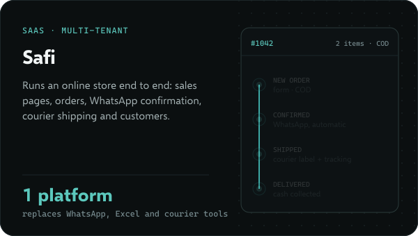

  

  
  

I lead product and engineering, and I still build. Six years shipping software for European clients: writing backends myself, then becoming the only manager in a 50-person software house running nine client projects at once, and now running product and engineering for a European health tech company. At [Sifartek](https://sifartek.com) we build AI systems that learn a business's whole process and use AI only where it actually helps.

### Things I've shipped

  
  

  
  

### How I work

  

### Stack

  

Client work lives in private repos.

